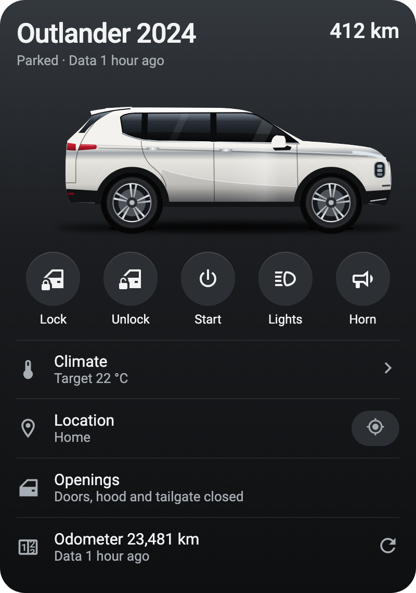
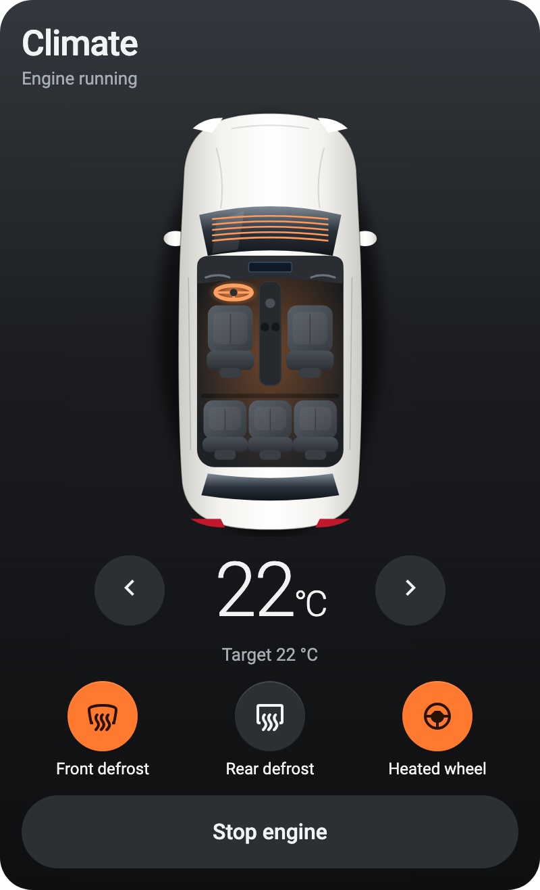
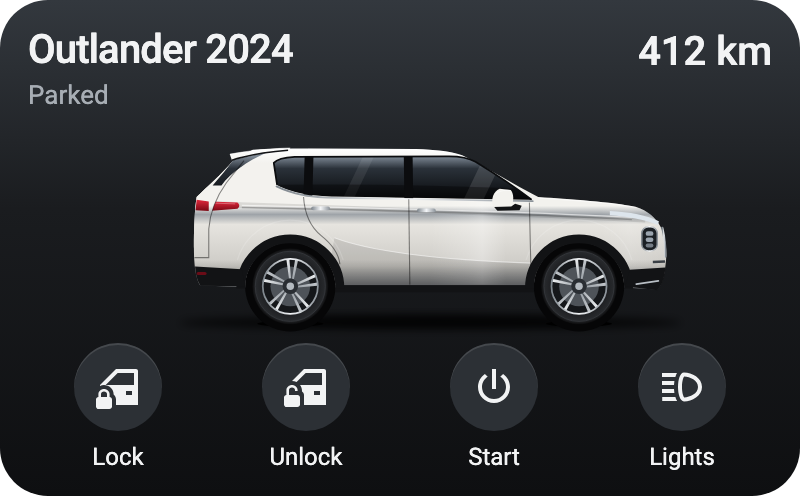
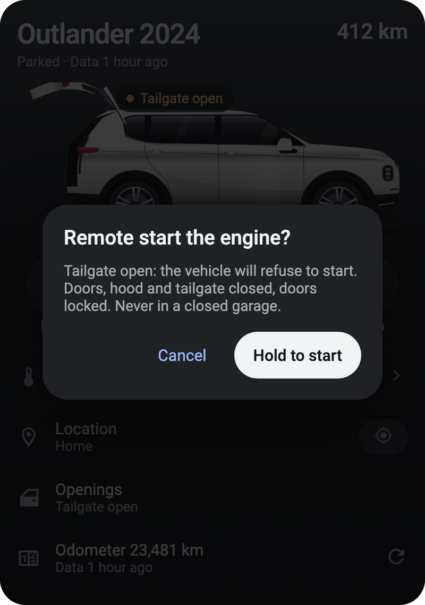

# Mitsubishi Connect for Home Assistant

Unofficial Home Assistant integration to monitor and control your own **Mitsubishi** vehicle (gas or PHEV) from your dashboard: lock, climate and remote start, status, location, and on plug-in models charging. It ships its own Lovelace cards and installs through HACS.

This is a personal, non-commercial project for owners who want their car in their own smart home. It is not affiliated with Mitsubishi Motors.

<p align="center">
  
  
</p>

## Features

- Lock and unlock, remote engine start and stop, flash lights, sound horn
- Remote start presets: cabin temperature, front and rear defrost, heated steering wheel
- Door, hood, tailgate, window, headlight and warning sensors, fuel range, odometer
- Plug-in hybrids: battery level, charging state, cable status and start or stop charging, shown only on PHEV/EV vehicles
- On-demand GPS location, rate-limited
- Dashboard cards shipped with the integration, loaded automatically
- Conservative polling that reads server-cached telemetry and never wakes the car on its own

## Installation (HACS)

1. Open **HACS** in Home Assistant, then the menu (`⋮`), then **Custom repositories**.
2. Add `https://github.com/damione1/mitsubishi-connect-ha` with the category **Integration**.
3. Install **Mitsubishi Connect** and restart Home Assistant.
4. Go to **Settings → Devices & Services → Add Integration → Mitsubishi Connect**.
5. Enter your region (`us` or `ca`), the **secondary driver** email and password, the 4-digit PIN and the poll interval.

The PIN is optional at setup, but remote start and unlock refuse to run without it. You can add or change it later in the integration options, together with the poll interval and the cabin temperature unit.

> [!TIP]
> **Use a dedicated secondary driver account.**
>
> The backend allows one active session per account, so signing in with your primary credentials from Home Assistant signs you out of the mobile app. In the official Mitsubishi Motors app, invite a **secondary driver** with its own email and password, grant the remote permissions you need, and use that account here.

## Dashboard Cards

The integration serves its cards and loads them on every dashboard, so there is no resource to add. After installing or updating, reload the browser once. The cards appear in the card picker as **Mitsubishi vehicle**, **Mitsubishi climate** and **Mitsubishi vehicle tile**.

| Vehicle | Climate | Tile | Remote start |
|:---:|:---:|:---:|:---:|
|  |  |  |  |

| Card | Contents | Size in sections views |
|---|---|---|
| `custom:mitsubishi-vehicle-card` | Vehicle render (tailgate drawn open when it is), lock, unlock, start or stop, lights, horn, then climate, location, openings, warnings and odometer rows | Full width, height follows content |
| `custom:mitsubishi-climate-card` | Top-down cabin showing the active presets, remote start temperature, front and rear defrost, heated wheel, start or stop | Full width, height follows content |
| `custom:mitsubishi-vehicle-tile` | Name, range, render and four quick commands | 12 columns × 4 rows |

### Safety

- **Remote start** opens a confirmation dialog and needs a **1.5 s hold** on its button. Releasing early, or the card redrawing during the hold, cancels it. This cannot be turned off.
- When a door, the hood or the tailgate is reported open, the dialog warns that the vehicle will refuse to start.
- **Unlock** asks for a confirmation unless `confirm: false`.
- The cards only guard their own buttons. The `Start Engine` button entity can still be pressed from other cards, automations or voice assistants: do not expose it to Assist if you want the hold to be the only way in.

### Options

```yaml
type: custom:mitsubishi-vehicle-card
device: 0123456789abcdef        # optional, defaults to the first Mitsubishi Connect vehicle
name: Outlander                 # optional, defaults to the device name
paint: blanc                    # blanc | titane | noir | rouge | bleu
roof_black: false
confirm: true                   # unlock confirmation
# image: /local/outlander.png               # photo instead of the drawn render
# image_trunk_open: /local/outlander-open.png
# climate_path: /dashboard-car/climate      # the Climate row navigates here instead of opening the preset
# entities:                                 # overrides by role
#   start_engine: button.my_vehicle_start_engine
```

| Option | Cards | Default | Description |
|---|---|---|---|
| `device` | all | first vehicle found | Device of the vehicle to show |
| `name` | all | device name | Title shown on the card |
| `paint` | vehicle, tile, climate | `blanc` | Body colour of the drawn render |
| `roof_black` | vehicle, tile | `false` | Two-tone black roof |
| `image`, `image_trunk_open` | vehicle, tile | none | Your own transparent PNG, with an optional tailgate-open variant |
| `climate_path` | vehicle | none | Dashboard path opened by the Climate row |
| `confirm` | all | `true` | Confirmation before unlock |
| `entities` | all | auto | Map of role to entity ID |

Entities are resolved through the vehicle's device, by translation key first and entity ID suffix second. Override a role under `entities` if you renamed an entity. Roles: `lock`, `unlock`, `start_engine`, `stop_engine`, `lights`, `horn`, `refresh`, `locate`, `tracker`, `engine`, `temperature`, `cabin_target`, `range`, `odometer`, `updated`, `front_defrost`, `rear_defrost`, `steering_heater`, `headlights`, `brake_warning`, `oil_warning`, `door_fl`, `door_fr`, `door_rl`, `door_rr`, `hood`, `trunk`. Plug-in hybrid roles, shown on PHEV/EV vehicles: `battery`, `ev_range`, `charging`, `fuel_level`.

Files under `/config/www` are served without authentication and cached for 31 days: hide the plate on a custom photo and change its file name when you replace it.

## Entities (per vehicle)

| Domain | Entities |
|---|---|
| `button` | Start Engine, Stop Engine, Lock Doors, Unlock Doors, Flash Lights, Sound Horn, Refresh Vehicle Status (10-min cooldown), Update GPS Location, plus Start Charging and Stop Charging on PHEV/EV |
| `sensor` | Odometer, Fuel Range, Target Cabin Temperature, Last Telemetry Update, plus Battery and Time to Full Charge on PHEV/EV |
| `binary_sensor` | Engine, 4 doors, Hood, Trunk, Headlights, Brake Warning, Engine Oil Warning, plus windows when reported, plus Charging Cable and Charging on PHEV/EV |
| `switch` | Configuration presets: Remote Start Front Defrost, Rear Defrost, Steering Wheel Heater |
| `number` | Configuration preset: Remote Start Temperature (`16–30 °C` / `60–86 °F`) |
| `device_tracker` | Vehicle location, updated on demand |

The PHEV/EV entities appear only when the vehicle reports as a plug-in model. Locks and the engine are exposed as action buttons rather than `lock` and `switch` entities, because the API does not report a reliable lock state. The trunk, hood and windows are read-only: the API has no command to open or close them.

## Account Safety

- **Persistent session and proactive token refresh**: the device UUID, OAuth tokens and ephemeral session keys are stored in Home Assistant and refreshed before they expire, so restarts do not trigger new logins.
- **Conservative passive polling**: every **60 minutes** by default (minimum **15 minutes**) with random jitter, reading **only** server-cached telemetry (`getVSR` and `getEngineDetails`) without waking the car.
- **Manual-only vehicle wake**: `Refresh Vehicle Status` (`refreshVSR`) runs only when pressed and enforces a **10-minute cooldown** to protect your account and the 12 V battery.
- **No retry storms**: authentication errors start Home Assistant's reauthentication flow instead of retrying the login endpoint.

## Also in this repository

The integration under `custom_components/mitsubishi_connect/` is self-contained. The rest of the repo documents the API it talks to, scoped to the same owner-control use case:

- `openapi/openapi.yaml` - an OpenAPI 3.2 spec covering only the endpoints an owner needs (gas + PHEV). Browse it with `uv run python openapi/swagger_server.py`.
- `generated/` - a typed async Python client generated from that spec.
- `client/` and `cli/` - a small SDK and an interactive CLI for the same commands (`uv run mitsubishi-connect --help`).
- `config/regions.toml` - regional backend settings, with per-app keys stored obfuscated and decoded at runtime.

Regenerate the client after editing the spec with `./scripts/generate_client.sh && uv sync`.

## Disclaimer

This project is an independent, unofficial client, not affiliated with, endorsed by or supported by Mitsubishi Motors Corporation. Its only goal is to let an owner use their own car's functions from their own Home Assistant. It is built to put no more load on the backend than the official app already does: one persistent session, conservative passive polling, and manual-only vehicle wake. Use it at your own risk, and never run a remote engine start in a closed or unventilated garage.
